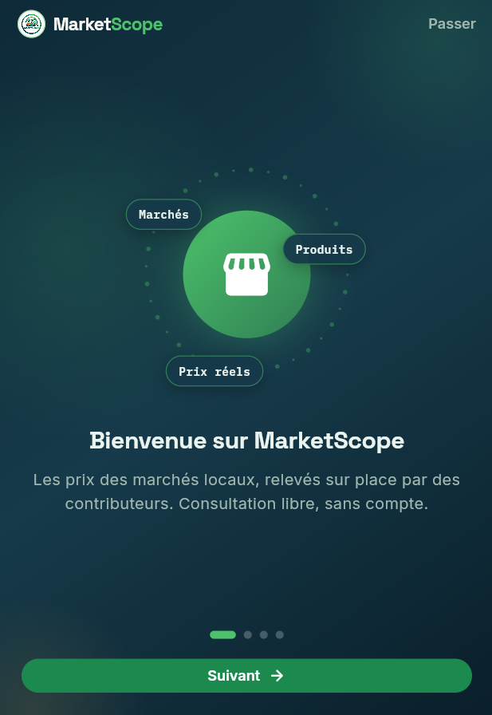
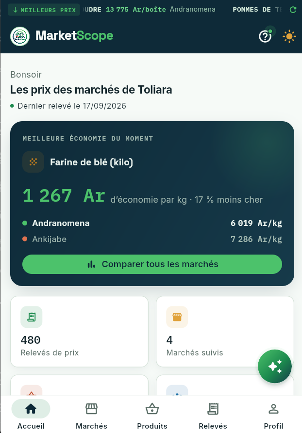
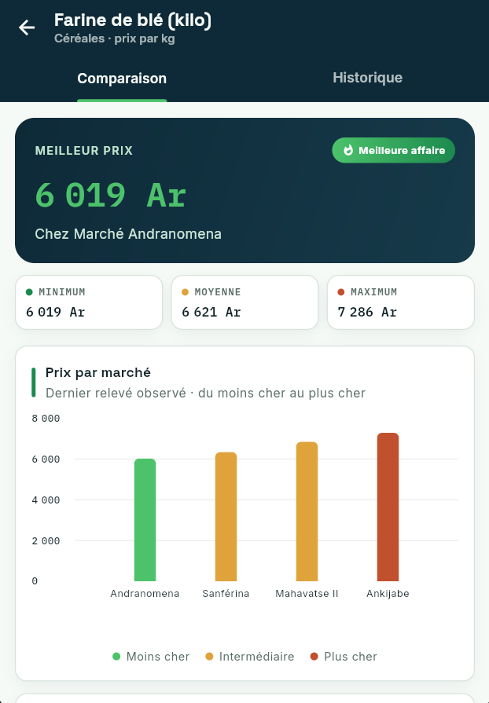
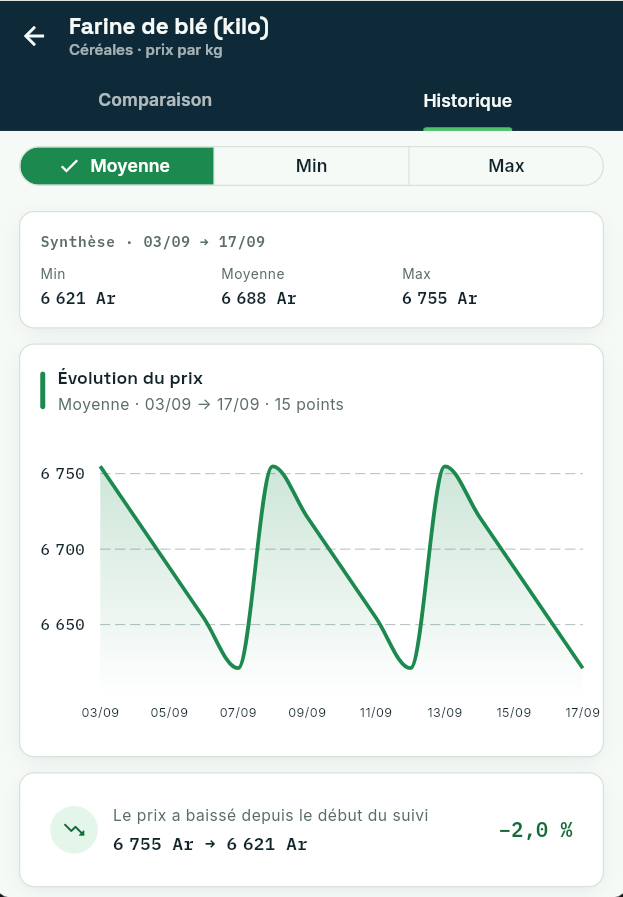
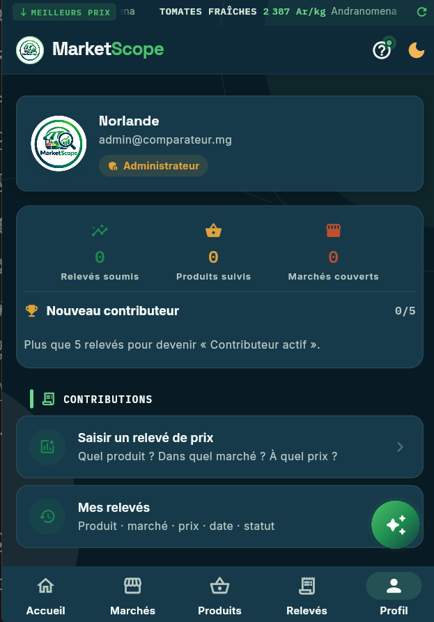
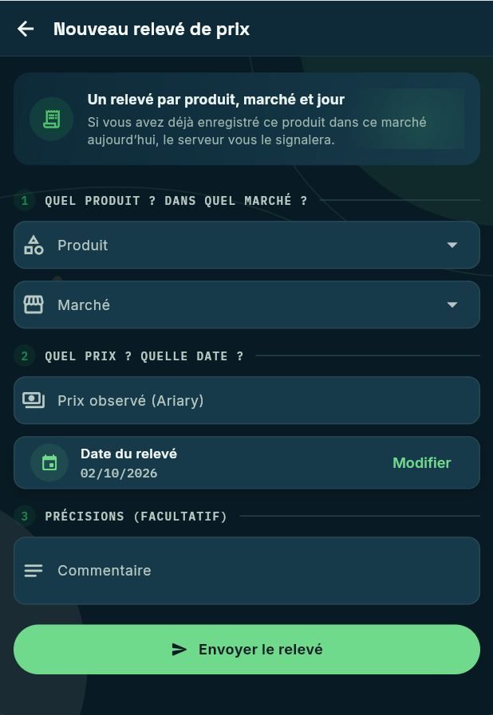
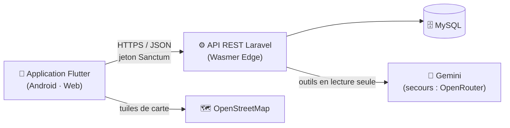

<p align="center">
  
</p>

<h1 align="center">MarketScope</h1>

<p align="center">
  <strong>Comparez, suivez et comprenez les prix des marchés locaux de Toliara (Madagascar).</strong><br>
  Application mobile Flutter + API Laravel — projet de fin d'études (ENI, 2026).
</p>

<p align="center">
  
  
  
  
  
  
  
</p>

<p align="center">
  <a href="https://github.com/Nicki24/comparateur-prix-marches/releases/latest">
    
  </a>
</p>

<p align="center">
  <a href="#-fonctionnalités">Fonctionnalités</a> ·
  <a href="#-captures-décran">Captures</a> ·
  <a href="#%EF%B8%8F-architecture">Architecture</a> ·
  <a href="#-démarrage-rapide">Démarrage</a> ·
  <a href="docs/DEPLOIEMENT.md">Déploiement</a> ·
  <a href="docs/API.md">API</a>
</p>

---

## 📌 Le projet

Sur les marchés de Toliara, le prix d'un même produit — riz, huile, sucre, tomates… — varie
d'un marché à l'autre et d'un jour à l'autre. **MarketScope** rassemble des relevés de prix
saisis sur le terrain par des contributeurs pour que chacun puisse savoir, en un coup d'œil,
**où acheter moins cher** et **comment les prix évoluent**.

- 🔓 **Consultation libre**, sans créer de compte.
- 📝 **Relevés de terrain** saisis par des contributeurs inscrits.
- 🛡️ **Données fiables** : relevés immuables, un relevé par jour et par marché, détection
  automatique des prix anormaux et obsolètes.
- 🇫🇷 Interface entièrement **en français**.

## ✨ Fonctionnalités

| Pour qui | Ce que l'on peut faire |
|---|---|
| **Tout le monde** (sans compte) | Comparer le prix d'un produit entre les marchés (écarts en %), suivre son évolution (graphiques moyenne / min / max), consulter les marchés, leur emplacement sur la carte et les chiffres de la plateforme. |
| **Contributeurs** | Créer un compte, saisir un relevé (produit, marché, prix, date), consulter l'historique de ses relevés et leur statut (valide, signalé, obsolète). |
| **Administrateur** | Gérer marchés et produits (créer, modifier, désactiver, réactiver, **fusionner les doublons**, supprimer ce qui n'a aucun relevé), **placer chaque marché sur la carte**, traiter les signalements, exporter les relevés en CSV. |
| **Assistant IA** 🤖 | Répond en langage naturel (« Où acheter le riz le moins cher ? », « Le marché le plus proche de moi ? ») à partir des **vraies données** de la plateforme, jamais inventées. Peut utiliser la position de l'utilisateur, uniquement s'il la partage. |

### Règles métier

- ⛔ Un relevé **ne peut plus être modifié** après son envoi.
- 🔁 **Un seul relevé par jour** pour un même contributeur, produit et marché.
- ⚠️ Un relevé qui s'écarte de **plus de 40 %** de la moyenne des 14 derniers jours est **signalé** automatiquement.
- 🕒 Un relevé de **plus de 14 jours** devient **obsolète** (tâche planifiée chaque nuit).
- 🗑️ Un marché ou produit **lié à des relevés ne peut pas être supprimé** — seulement désactivé ou fusionné — pour préserver l'historique des prix.

## 📸 Captures d'écran

| | | |
|:-:|:-:|:-:|
|  |  |  |
|  |  |  |

## 🏗️ Architecture



| Couche | Technologies | Dossier |
|---|---|---|
| 📱 Application mobile | Flutter 3.32 · Dart 3.8 · Material 3 | [`frontend/`](frontend/) |
| ⚙️ API REST | Laravel 13 · PHP 8.3+ · Sanctum | [`backend/`](backend/) |
| 🗄️ Base de données | MySQL 8 | migrations dans [`backend/database/`](backend/database/) |
| ☁️ Hébergement | Wasmer Edge (API + MySQL) | [`backend/app.yaml`](backend/app.yaml) |

### Principales bibliothèques

| Côté application (Flutter) | Rôle |
|---|---|
| `http` | Appels à l'API |
| `fl_chart` | Graphiques d'évolution et de comparaison des prix |
| `flutter_map` + `latlong2` | Carte OpenStreetMap (sans clé d'API) |
| `geolocator` | Position de l'utilisateur (sur demande uniquement) |
| `flutter_secure_storage` | Jeton de connexion chiffré (Keystore Android) |
| `phosphor_flutter` | Icônes |
| `intl` | Formats français (dates, Ariary) |

| Côté API (Laravel) | Rôle |
|---|---|
| Laravel Sanctum | Authentification par jetons |
| Rate limiting Laravel | Protection contre le bourrage d'identifiants et les abus |
| Gemini / OpenRouter (HTTP) | Assistant IA avec appels d'outils |

## 🧭 Structure du dépôt

```
comparateur-prix-marches/
├── backend/              API REST Laravel
│   ├── app/              Contrôleurs, modèles, services (assistant IA, anomalies…)
│   ├── database/         Migrations et seeders
│   ├── routes/api.php    Les 30 routes de l'API
│   ├── tests/            56 tests (règles métier, sécurité, géolocalisation…)
│   ├── app.yaml          Configuration Wasmer Edge
│   └── wasmer.toml       Paquet Wasmer (PHP 8.3)
├── frontend/             Application Flutter
│   ├── lib/screens/      Écrans (accueil, comparaison, carte, saisie, admin…)
│   ├── lib/services/     Accès à l'API, session, localisation
│   ├── lib/widgets/      Design system MarketScope (cartes, boutons, états…)
│   ├── lib/theme/        Thème clair / sombre (jetons de couleur WCAG AA)
│   └── test/             40 tests (widgets, accessibilité, modèles)
├── docs/                 Documentation, captures et documents du mémoire
└── scripts/              Script de déploiement de l'API
```

## 🚀 Démarrage rapide

### Prérequis

- **PHP 8.3+** (extensions `pdo_mysql`, `mbstring`, `openssl`) et **Composer 2**
- **MySQL 8**
- **Flutter 3.32+** avec le SDK Android (et le NDK 26.3.11579264 pour la version de production)

### 1. API (Laravel)

```bash
git clone https://github.com/Nicki24/comparateur-prix-marches.git
cd comparateur-prix-marches/backend
composer install
cp .env.example .env          # puis renseigner la connexion MySQL (DB_*)
php artisan key:generate
php artisan migrate --seed    # données de démonstration
php artisan serve             # → http://localhost:8000
```

> Le seeder crée des comptes et des prix **de démonstration** pour le développement local.
> Leurs identifiants se trouvent dans [`backend/database/seeders/DatabaseSeeder.php`](backend/database/seeders/DatabaseSeeder.php) ;
> ils ne doivent jamais être utilisés en production.

### 2. Application (Flutter)

```bash
cd ../frontend
flutter pub get
flutter run                   # émulateur Android, appareil ou Chrome
```

En développement, l'application appelle l'API locale (`http://localhost:8000/api`, ou
`http://10.0.2.2:8000/api` depuis l'émulateur Android). La version de production
(`flutter build apk`) appelle l'API en ligne. Pour forcer une autre adresse :

```bash
flutter run --dart-define=API_URL=https://mon-serveur.exemple/api
```

## ✅ Qualité

| | Commande | Résultat |
|---|---|---|
| Tests API | `cd backend && php artisan test` | 56 tests au vert |
| Tests application | `cd frontend && flutter test` | 40 tests au vert |
| Analyse statique | `cd frontend && flutter analyze` | aucune alerte |
| Dépendances PHP | `cd backend && composer audit` | aucune faille connue |

> Les tests de l'API utilisent une base MySQL dédiée, `comparateur_prix_test` (voir [`backend/phpunit.xml`](backend/phpunit.xml)).

### Sécurité

- Jeton de session stocké **chiffré** (`flutter_secure_storage`), jamais en clair.
- **Limitation des tentatives** : 5 connexions / minute par compte et IP, 10 inscriptions / heure par IP.
- Jetons Sanctum **expirant après 30 jours**, révoqués à la déconnexion.
- Export CSV protégé contre l'**injection de formules** (Excel).
- Clés d'IA et secrets **uniquement côté serveur** ; aucune clé dans l'application.
- Sauvegarde Android désactivée (`allowBackup="false"`) ; HTTPS obligatoire en production.

### Accessibilité (WCAG 2.2 AA)

- Contrastes vérifiés (texte ≥ 4,5:1, contours de champs ≥ 3:1) en thème clair et sombre.
- Chargements et erreurs annoncés aux lecteurs d'écran (TalkBack, NVDA).
- Animations désactivées si l'utilisateur a choisi « réduire les animations ».
- Cibles tactiles ≥ 48 dp, boutons d'icônes avec libellés, zoom de carte au bouton.

## 📲 Installer l'application

Téléchargez **`MarketScope-1.0.0.apk`** depuis la
[dernière release](https://github.com/Nicki24/comparateur-prix-marches/releases/latest),
ouvrez-le sur votre téléphone Android (6.0 ou plus récent) et autorisez l'installation
d'applications inconnues lorsque le système le demande.

## ☁️ Déploiement

L'API est hébergée sur **[Wasmer Edge](https://wasmer.io)** (offre gratuite, base MySQL
incluse) et l'application est distribuée sous forme d'**APK Android signé**. Toutes les
étapes — secrets, premier déploiement, mise à jour, signature et distribution de l'APK —
sont détaillées dans **[`docs/DEPLOIEMENT.md`](docs/DEPLOIEMENT.md)**.

## 📚 Documentation

| Document | Contenu |
|---|---|
| [`docs/API.md`](docs/API.md) | Les 30 routes de l'API, leurs accès et leurs règles |
| [`docs/DEPLOIEMENT.md`](docs/DEPLOIEMENT.md) | Mise en ligne de l'API et publication de l'APK |
| [`docs/memoire/`](docs/memoire/) | Cahier des charges, dossier de conception, MCD/MLD, rapport de suivi |

## 👤 Auteur

**Norlande** — projet de fin d'études, **École Nationale d'Informatique (ENI)**, 2026.

<sub>Application pédagogique réalisée dans le cadre d'un mémoire de fin d'études.</sub>
